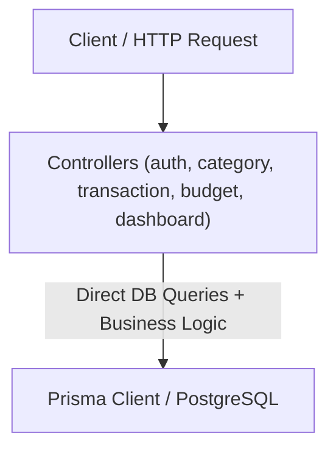
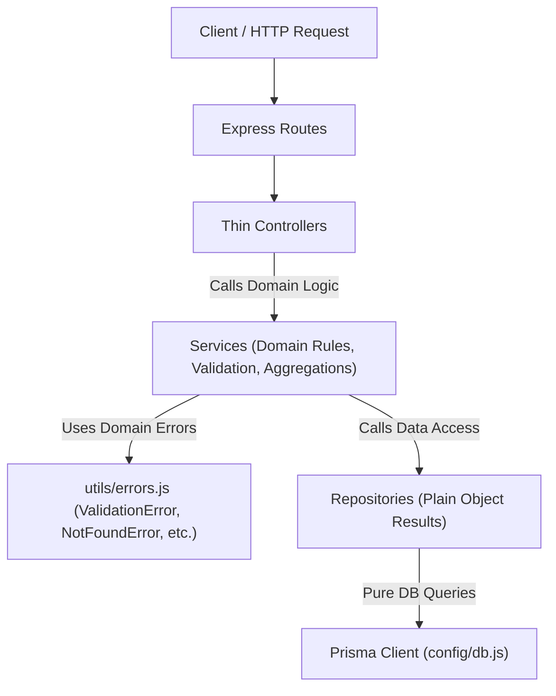

# Backend Refactoring Report: Controller-Service-Repository Layered Architecture

## 1. Overview
The ExpenseMate backend has been restructured from a monolithic controller architecture into a strict three-tier layered architecture:
1. **Controllers**: HTTP transport handling, extracting request params/body/cookies, invoking services, returning standard JSON status codes and payloads.
2. **Services**: Domain business logic, input validation rules, ownership enforcement, metrics computation, password hashing, and token handling.
3. **Repositories**: Isolated database abstraction layer performing queries through Prisma. Plain JavaScript objects are returned with generic `id` fields to prevent vendor leak.

---

## 2. Architectural Structure (Before vs. After)

### Before Architecture
Controllers directly imported the Prisma client, mixed request validation with raw database queries, calculated domain formulas inline, and sent responses.

### After Architecture
Responsibilities are decoupled with strictly enforced unidirectional dependencies:

---

## 3. Features Refactored

All five core functional modules have been lifted and shifted into the layered structure:

1. **Authentication (`auth`)**:
   - `userRepository`: Handles user lookup by email/ID and user creation.
   - `authService`: Handles credential validation, password hashing with bcrypt, JWT creation, and session retrieval.
   - `authController`: Sets HTTP-only cookies, coordinates login/signup/logout endpoints, and maps domain errors to status codes.

2. **Categories (`category`)**:
   - `categoryRepository`: Queries categories by user/name and persists custom categories.
   - `categoryService`: Enforces category creation rules and merges system defaults with user categories.
   - `categoryController`: Thin handler responding with standard category payloads.

3. **Transactions (`transaction`)**:
   - `transactionRepository`: CRUD operations and pagination queries for transactions.
   - `transactionService`: Validates positive amounts, auto-provisions categories if missing, validates transaction ownership against current authenticated user, and handles pagination calculation.
   - `transactionController`: Dispatches request parameters to service methods.

4. **Budgets (`budget`)**:
   - `budgetRepository`: Performs upsert operations keyed on user, month, and year.
   - `budgetService`: Validates monthly budget figures and supplies default values when no budget is defined.
   - `budgetController`: Handles get/set budget requests.

5. **Dashboard (`dashboard`)**:
   - `dashboardService`: Computes total balances, monthly savings, 6-month historical cash-flow trends, growth percentages, and budget usage metrics.
   - `dashboardController`: Surfaces complete dashboard statistics to the client.

---

## 4. Code-Quality Improvements

1. **Separation of Concerns & Maintainability**:
   - Business calculations (such as rolling 6-month spending totals and budget percentage limits) are no longer tied to HTTP request/response lifecycles, enabling reusability and isolated unit testing.
2. **Database Agnosticism**:
   - Repositories return sanitized plain objects instead of Prisma-specific models or leaking Prisma client calls into controllers or services. This enables database engine migration without touching controllers or services.
3. **Standardized Error Handling**:
   - Replaced ad-hoc error handling with domain errors (`ValidationError`, `NotFoundError`, `AuthError`, `ForbiddenError`) in `utils/errors.js`, preserving identical HTTP status codes and contract messages.
4. **Architectural Boundary Enforcement**:
   - Added automated architectural linting using `dependency-cruiser` (`npm run check:layers`) to guarantee no controller bypasses services or accesses the database directly.

---

## 5. Metrics
<!-- TODO: Metrics section to be filled in final assignment phase -->
TODO
